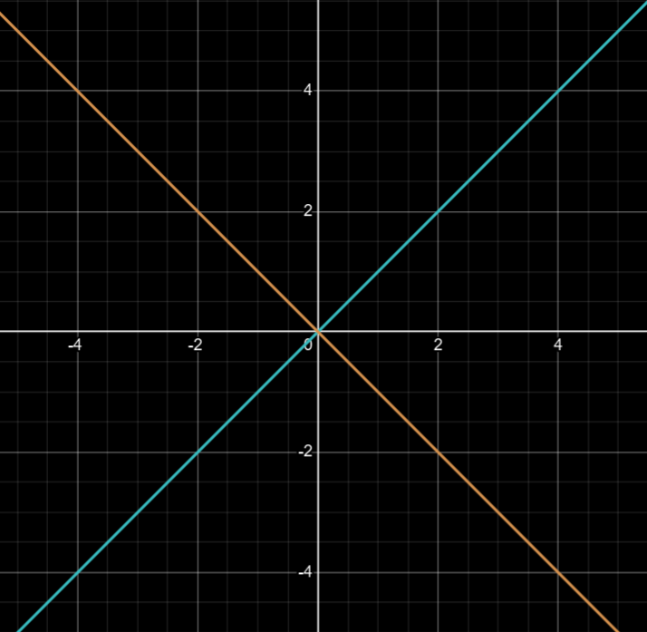
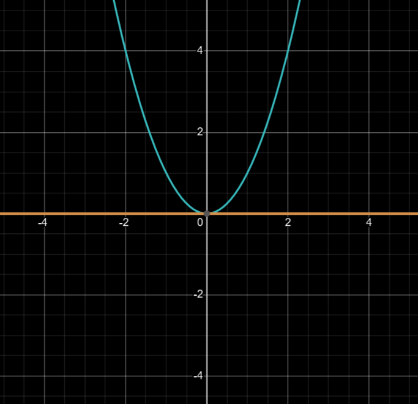
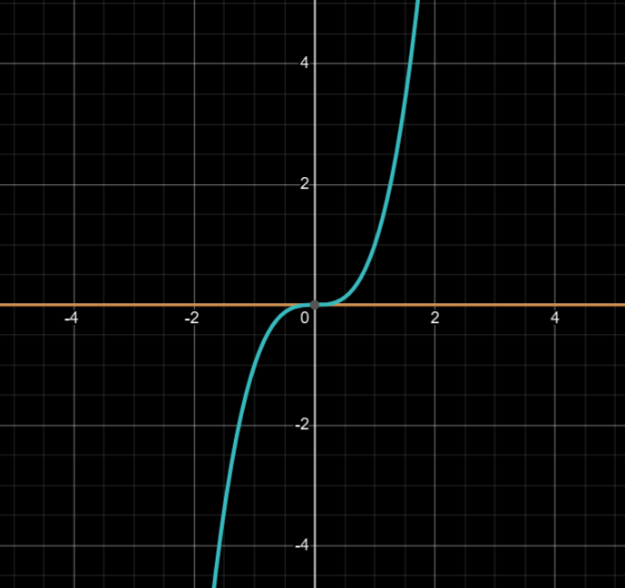

# Calculating the Intersection Multiplicity of Algebraic Curves

## About the Project

This C++ project computes the **intersection multiplicity** of two plane algebraic curves
$f(x,y)=0$ and $g(x,y)=0$ at the origin $(0,0)$.

In algebraic geometry, the intersection multiplicity $m(f,g)$ measures how "strongly"
two curves touch at a given point. It is a local invariant and a fundamental ingredient
of **Bézout's theorem**.

The implementation works at the origin; multiplicities at other points are obtained by
translating the coordinates so that the point becomes the origin.

### What is multiplicity?

| Multiplicity | Geometric meaning | Example |
|:---:|---|---|
| 1 | Transversal crossing ("X" shape): the curves have different tangents | $y=x$ and $y=-x$ |
| 2 | Tangency: the curves share a tangent and touch without crossing | $y=x^2$ and $y=0$ |
| 3+ | Higher-order tangency (osculation): the curves agree to higher derivatives | $y=x^3$ and $y=0$ |

---

## Visual Examples (Desmos)

### 1. Multiplicity 1: Simple intersection
Two lines crossing at the origin. Their gradients (tangents) are different.

> **Graph:** $y=x$ and $y=-x$



### 2. Multiplicity 2: Tangency
The parabola touches the $x$-axis exactly at its vertex. Both curves have the same tangent
at this point.

> **Graph:** $y=x^2$ and $y=0$



### 3. Multiplicity 3: Higher-order tangency
The cubic flattens out completely at the origin: it matches the first and second derivatives
of the $x$-axis before crossing it.

> **Graph:** $y=x^3$ and $y=0$



---

## Mathematical Algorithm

The algorithm is a Euclidean-style recursion for polynomials. It relies on the following
properties of multiplicity:

1. **Trivial (vanishing) case.** $m(f,g)=0$ if $f(0,0)\neq 0$ or $g(0,0)\neq 0$.
2. **Invariance under adding a multiple.** $m(f,g)=m(f\,g+a\cdot f)$ for any polynomial $a(x,y)$.
3. **Additivity in the second argument.** $m(f\,g\cdot h)=m(f,g)+m(f,h)$.
4. **Base case.** $m(x,y)=1$.

Together with the symmetry $m(f,g)=m(g,f)$, these properties drive the recursion.

### Step-by-step execution

1. **Eliminate the highest power of $x$.**
   If neither polynomial is divisible by $y$, substitute $y=0$ and write
   $$f(x,0)=\alpha x^k+\dots,\qquad g(x,0)=\beta x^l+\dots$$
   with $l\ge k$ (swap $f$ and $g$ if necessary). Replace
   $$g \leftarrow g-\frac{\beta}{\alpha}x^{l-k}f,$$
   which cancels the leading term $\beta x^l$ of $g(x,0)$ and strictly lowers its
   $x$-degree.

2. **Factor out $y$.**
   Since both curves pass through the origin and the $x$-degree strictly decreases at
   every elimination step, eventually one polynomial becomes divisible by $y$, say
   $g=y\cdot h$. By property 3,
   $$m(f,g)=m(f,y)+m(f,h).$$

3. **Compute $m(f,y)$.**
   This is the multiplicity of the intersection of $f$ with the $x$-axis ($y=0$):
   substitute $y=0$ and take the **lowest** power of $x$ in $f(x,0)$. Add this value
   to the result.

4. **Repeat.**
   Continue with the pair $(f,h)$ until the trivial case (property 1) applies.

> **Note.** The algorithm assumes the two curves have no common component through the
> origin; otherwise the intersection is not isolated and the multiplicity is infinite.

---

## Technical Implementation

The project follows modern C++ (C++17) and OOP principles.

- **`Monom`** — a struct representing a single term $c\,x^a y^b$.
- **`Polynomial`** — encapsulates `std::vector<Monom>`. Provides algebraic operations
  (`simplify`, `subtractMultipleOf`, `divideByY`) and a canonical monomial ordering
  (tuple comparison via `std::tie`).
- **`Multiplicity`** — the core recursive algorithm.
- **Precision** — coefficients are stored as `double`, so the elimination step can divide
  by the leading coefficient; comparisons against zero use an epsilon of `1e-9`.

### Project Structure

```text
├── .github/workflows/        # CI/CD pipeline (GitHub Actions)
├── cpp/
│   ├── Monom.h/.cpp
│   ├── Polynomial.h/.cpp
│   ├── Multiplicity.h/.cpp   # Core algorithm
│   └── main.cpp
├── tests/
│   └── MultiplicityTest.cpp  # Unit tests (GoogleTest)
└── CMakeLists.txt            # Build system
```

### Build and Test

```bash
cmake -S . -B build
cmake --build build
ctest --test-dir build --output-on-failure
```

The CLI target name is defined in `CMakeLists.txt`.
